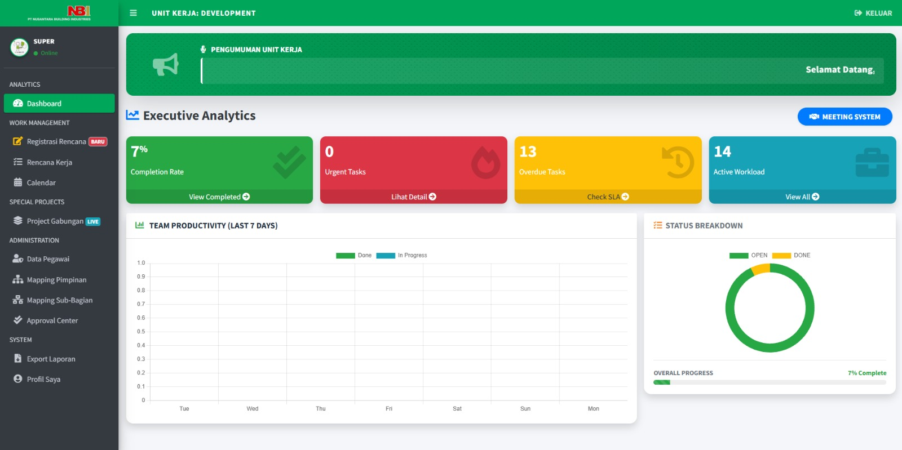
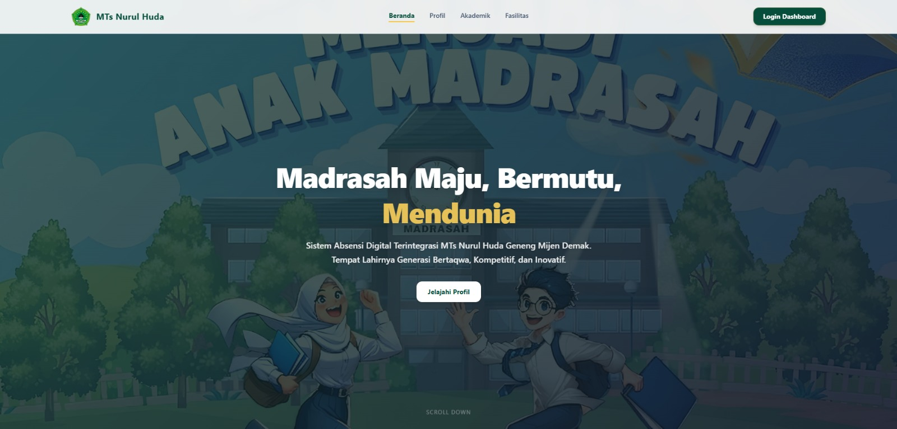
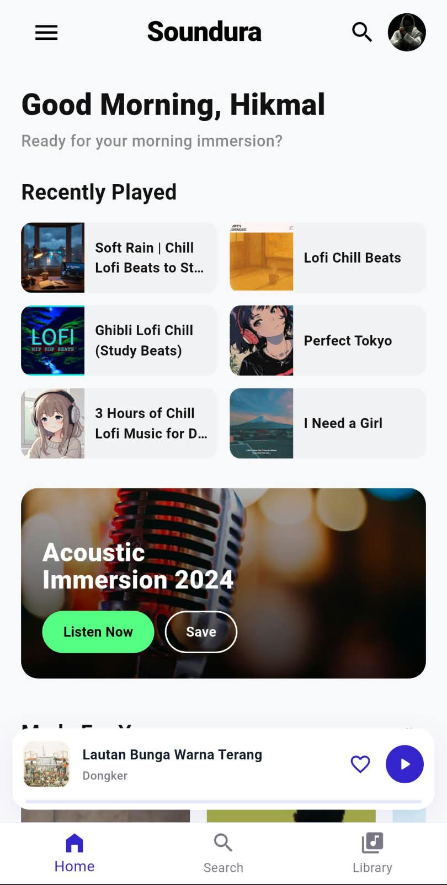

## 🚀 Featured Projects

> Some of these are internal company systems, so the source code is private. Screenshots show the interface only (sensitive data blurred).

### 🏭 NBI Work & Project Management · 🔒 Private

Executive analytics dashboard for work planning and tracking: completion rate, urgent and overdue tasks with SLA check, active workload, team productivity charts, calendar, approval center, leadership mapping, and report export.

**Stack:** [isi stack]

---

### 🎫 NBI IT Portal (Helpdesk & Work Order) · 🔒 Private

IT helpdesk portal covering ticket tracking, a work order queue per department and technician, ticket trend and service category analytics, IT inventory, PC and asset master data, warehouse logistics, a WhatsApp gateway bot, and database backup. Used across ~130 PCs.

**Stack:** [isi stack]

---

### 🏫 Digital Attendance System · MTs Nurul Huda

QR-based digital attendance system for a madrasah in Demak, with a public school profile site and a dashboard login for staff.

**Stack:** [isi stack]

---

### 🎵 Soundura · Music App

Mobile music app with a personalized home screen, recently played, featured playlists, search, library, and a mini player.

**Stack:** [isi stack]
