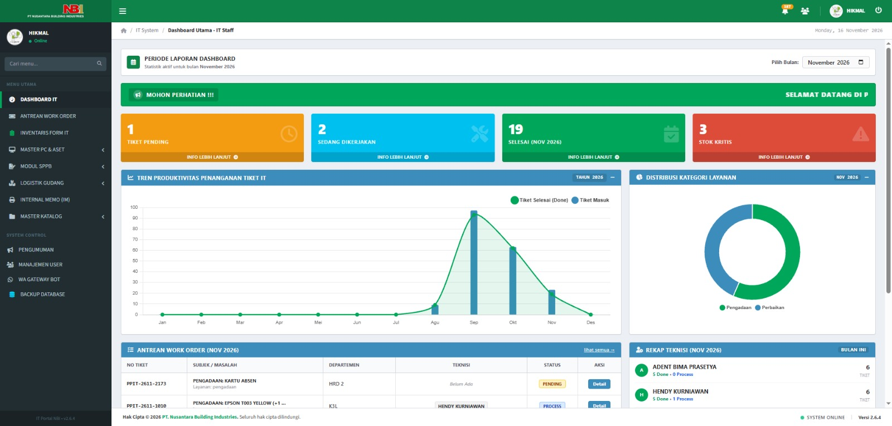

  

<table align="center">
  <tr>
    <td align="center" width="240">
      
    </td>
    <td valign="middle">
      <h2>Full-Stack Developer</h2>
      
Building ERP, ticketing, and SLA systems for factory operations. 
      I started in IT support and networking, so I build software around real operational needs.

      

        
        
        
      

    </td>
  </tr>
</table>

---

## 👋 About Me

- ⚡ **Currently:** building an ERP, a ticketing system, and real-time SLA tracking for factory operations
- 🎯 **Looking for:** remote Full-Stack roles (Laravel, Next.js, ERP)
- 🔐 **Security-minded:** SQL Injection prevention, Cisco and EC-Council certified
- 🌐 **Infra background:** LAN/WAN, fiber optic, IP CCTV, MikroTik

---

## 🚀 Featured Projects

> Some of these are internal company systems, so the source code is private. Screenshots show the interface only (sensitive data blurred).

### 🏭 NBI Work & Project Management · 🔒 Private

Executive analytics dashboard for work planning and tracking: completion rate, urgent and overdue tasks with SLA check, active workload, team productivity charts, calendar, approval center, leadership mapping, and report export.

---

### 🎫 NBI IT Portal (Helpdesk & Work Order) · 🔒 Private

IT helpdesk portal covering ticket tracking, a work order queue per department and technician, ticket trend and service category analytics, IT inventory, PC and asset master data, warehouse logistics, a WhatsApp gateway bot, and database backup. Used across ~130 PCs.

---

### 🏫 Digital Attendance System · MTs Nurul Huda

QR-based digital attendance system for a madrasah in Demak, with a public school profile site and a dashboard login for staff.

---

### 🎵 Soundura · Music App

Mobile music app with a personalized home screen, recently played, featured playlists, search, library, and a mini player.

---

## 🛠️ Tech Stack

<table>
  <tr>
    <td align="center" width="25%">💻 <b>Development</b> Laravel · Next.js CodeIgniter 3</td>
    <td align="center" width="25%">🗄️ <b>Databases</b> MySQL · PostgreSQL MS SQL Server</td>
    <td align="center" width="25%">🔐 <b>Security</b> SQL Injection prevention Cryptography</td>
    <td align="center" width="25%">🌐 <b>Infrastructure</b> Linux · MikroTik IP CCTV · Fiber optic</td>
  </tr>
</table>

  
   
  

---

## 🤝 Let's Connect

  

  <i>"No technical problem is too big; there is always a solution through persistence."</i>

